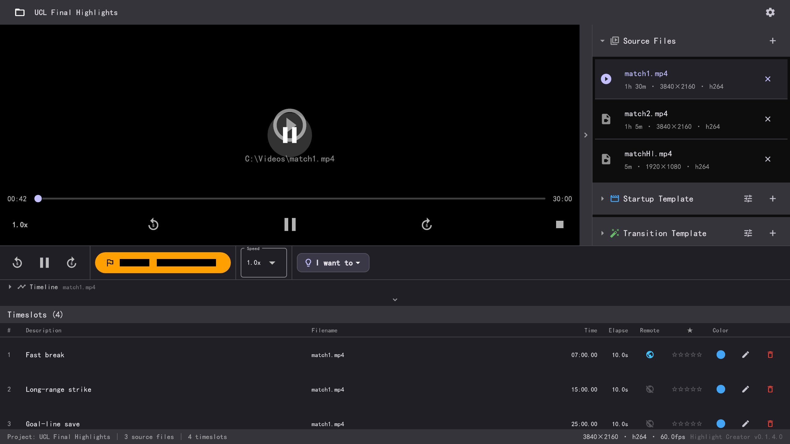

# Highlight Creator

Highlight Creator turns game or sports footage into edited highlight reels — mark
the moments, add transitions and effects, and render a finished MP4 up to 4K. It
also builds weekly / monthly / yearly **Top-5 and Top-10 reels**, and can narrate
them in **your own cloned voice** with an optional local engine: no cloud, no API
key, audio never leaves the machine.

**Windows only for now.** The Microsoft Store build is the supported release;
macOS, Android and iOS are planned, not available.



[简体中文](README.zh-CN.md)

## Install

**Microsoft Store (Windows):** search for **Highlight Creator** in the Microsoft
Store, or open <https://apps.microsoft.com/detail/9P19GR9SXLJW>.

You can also build from source — Highlight Creator is a Flutter desktop app backed
by a Rust + FFmpeg engine. On Windows the ffmpeg binary is bundled under
`tools/ffmpeg/`.

Prerequisites:

- [Flutter SDK](https://docs.flutter.dev/get-started/install) >= 3.22.0
- [Rust toolchain](https://rustup.rs/) (stable, edition 2024)
- [ffmpeg](https://ffmpeg.org/) — bundled under `tools/ffmpeg/` for Windows; without
  it the app runs in simulation mode instead of real rendering

The LGPL FFmpeg and libmpv binaries are not committed. Fetch them once:

```powershell
powershell -ExecutionPolicy Bypass -File fetch_lgpl_deps.ps1
```

Build for Windows desktop:

```bash
cd app
flutter pub get
flutter build windows
```

The executable lands in `app/build/windows/x64/runner/Release/`. For a debug build
with hot-reload use `flutter run -d windows`.

## Use

Talk to the app with your mouse or keyboard:

1. **Add videos** — import the source footage (up to 4K).
2. **Mark highlights** — drop an in/out point on the timeline for every moment you
   want to keep; label, rate, and describe each slot.
3. **Make the highlight** — the pipeline slices each clip, generates a text
   transition, applies effects (including a smooth zoom-pan for *remote* shots),
   mixes optional background music, and combines everything into one MP4.
4. **Export** — pick 720p, 1080p, or 4K (3840×2160).

All processing runs locally — videos never leave your machine.

## Why Highlight Creator

- **Fast marking.** Precise seeking, frame stepping, and thumbnail scrubbing make
  finding the right frame quick.
- **Broadcast touches.** Text transitions, startup/ending templates, and a smooth
  1×→1.7× zoom-pan effect for remote shots.
- **Up to 4K export.** 720p/1080p/4K presets from any source resolution.
- **Offline-first and private.** No account, no cloud, no network required.
- **Highlight reels, automatically.** Weekly / monthly / yearly Top-5 and Top-10
  reels, built from the project's marked slots (or from the reels below them), with
  intro cards, per-rank transitions and an ending.
- **Your own voice, on your own machine.** An optional local cloning engine narrates
  the reel in your voice, with a voice-pack format you can share, an intonation
  reference, a speed control and a natural-language tone instruction. It needs a
  Windows PC with a 6 GB GPU and is installed separately — see
  [voice_clone.md](docs/voice_clone.md). Without it the reel still renders, using a
  Windows system voice.
- **Flutter UI, native core.** A Flutter desktop shell over a Rust + FFmpeg engine
  for the heavy lifting. Today that ships on Windows only.

## Hardware requirements — 4K input → 4K output

Processing 4K video is **CPU- and memory-heavy**. The pipeline decodes 4K sources,
resizes to the export resolution, runs filter chains (`scale`, `pad`, `drawtext`,
`geq`, and a `zoompan` that pre-scales frames to ~3.125× the output width — about
12,000 px wide for a 4K export), then software-encodes with `libopenh264`. A smooth
60 fps preview also benefits from hardware video decoding.

Recommended OS: **Windows 10 22H2 (64-bit) or Windows 11 (64-bit)**.

| Component | Minimum | Recommended |
|---|---|---|
| OS | Windows 10 22H2 / Windows 11, 64-bit | Windows 11 (64-bit) |
| CPU | 6 cores / 12 threads (Intel Core i5‑12400/12500, AMD Ryzen 5 5600) | 8+ cores / 16+ threads (Intel Core i7‑12700K/13700K, AMD Ryzen 7 7700X/7800X3D) |
| RAM | 16 GB (DDR4 3200+) | 32 GB (dual-channel DDR5 preferred) |
| GPU | iGPU with hardware video decode (Intel UHD / AMD Radeon) | Dedicated GPU, DX11 + hard decode (NVIDIA RTX 3060/4060, AMD RX 6600/7600) |
| Storage | SSD, ≥ 20 GB free | NVMe SSD (PCIe 3.0/4.0), ≥ 100 GB free |
| Display | 1080p or higher | 4K monitor (or 1440p+) for accurate preview |

**Why these specs**

- **CPU is the bottleneck.** Every stage — decode, filter, 4K `libopenh264` encode,
  concat re-encode — is CPU-bound; more cores cut render time directly.
- **RAM matters for remote (zoom) shots.** `zoompan` keeps several
  multi-thousand-pixel frames in memory; a 12,000 × ~6,750 px YUV frame alone is
  ≈ 100+ MB. 16 GB covers typical projects, 32 GB leaves headroom for long,
  multi-clip timelines.
- **GPU helps preview, not export (today).** The current encoder is `libopenh264`
  (software, BSD-licensed — see *License* below). A GPU with hardware decode keeps
  4K scrubbing smooth at 60 fps; NVENC support positions you for a future
  hardware-encode option.

> Note: the default export resolution is 1280×720. Select the **4K** chip on the
> Export screen for 3840×2160 output.

## Safety

Highlight Creator is offline-first: video processing and project data stay local
by default, and the app works fully without a network connection. All rendering is
done by a bundled FFmpeg; no telemetry or account is required.

## Build & test

```bash
cd app
flutter analyze        # lint / static checks
flutter test           # unit + widget tests

# E2E full pipeline (needs fixtures in test/e2e/videoSource/; the Make step
# calls ffmpeg and takes 2–5 minutes depending on CPU)
flutter test test/e2e/use_case_test.dart

# Faster E2E subsets
flutter test --plain-name "ordering" test/e2e/use_case_test.dart
flutter test --plain-name "zero"     test/e2e/use_case_test.dart

# README screenshots (regenerates app/windows/res/screenshot_*.png)
flutter test test/e2e/readme_screenshot_test.dart
```

## Documentation

- [Architecture](ARCHITECTURE.md) — modules, data flow, performance strategy
- [In-app user guide](app/windows/res/guide_en_01.png) — step-by-step screenshots
- [Implementation plan](IMPLEMENTATION_PLAN.md)
- [Issues & roadmap](issues.md)
- [Use cases](UseCase.md)
- [`.hlcproj` format](docs/hlcproj_format.md) — project file spec, for a phone or
  tablet companion that marks clips and hands the work to the desktop
- [Local voice cloning plugin](docs/voice_clone.md) — install, voice packs, protocol

## License

Highlight Creator is released under the **GNU Lesser General Public License v3.0**
(see [LICENSE](LICENSE); [COPYING](COPYING) holds the GPLv3 terms that the LGPLv3
incorporates by reference).

Rendering never links FFmpeg into the app: it is driven as an external
`ffmpeg` executable. The code invokes only LGPL-compatible filters
(`scale`, `pad`, `drawtext`, `drawbox`, `zoompan`, `geq`, `overlay`, …) and the
BSD-2-Clause `libopenh264` encoder, so it can ship next to an **LGPL FFmpeg
build** (configured without `--enable-gpl`). Distributors must not bundle a GPL
FFmpeg build: GPL-only components such as `libx264`, `libx265`, `frei0r`,
`libvidstab`, and `libxvid`, plus the `eq`/`boxblur`/`hqdn3d` filters, are
off-limits under this license.

> The video *preview* uses `media_kit`, whose Windows package ships a GPLv2+
> `libmpv-2.dll`. The build and packaging scripts replace it with an LGPL
> libmpv — see below.

### LGPL binaries

The bundled binaries are LGPL builds fetched by `fetch_lgpl_deps.ps1`:

- **FFmpeg** (LGPL static, [BtbN/FFmpeg-Builds](https://github.com/BtbN/FFmpeg-Builds))
  → `tools/ffmpeg/`. No `--enable-gpl`; includes `libopenh264`, `drawtext`,
  `geq`, `zoompan`, `drawbox`.
- **libmpv** (LGPL, [zhongfly/mpv-winbuild](https://github.com/zhongfly/mpv-winbuild))
  → `tools/mpv/libmpv-2.dll`. `app/windows/CMakeLists.txt` installs it over
  media_kit's GPL DLL after every build; `pack_release.bat` also refuses to
  package a release without it.

Run once before building or packaging:

```powershell
powershell -ExecutionPolicy Bypass -File fetch_lgpl_deps.ps1
```

See [THIRD_PARTY_NOTICES.txt](THIRD_PARTY_NOTICES.txt) for source and license
details.

## Contributing

Report bugs, missing features, or awkward workflows by [opening an
issue](https://github.com/anomalyco/opencode/issues). Commits follow conventional
commits (`feat:`, `fix:`, `docs:`, `refactor:`, `test:`, `chore:`).