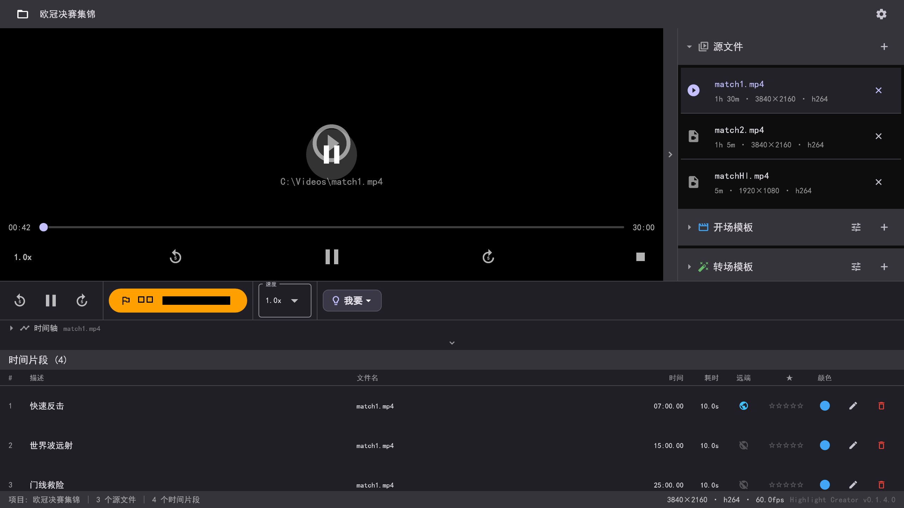

# Highlight Creator（集锦创作器）

Highlight Creator 是一款跨平台工具，帮你把比赛或运动素材剪成成品集锦 —— 标记精彩瞬间、添加转场与特效，最终渲染为最高 4K 的 MP4 视频。



[English](README.md) · 简体中文

## 安装

Highlight Creator 是基于 Flutter 的桌面应用，底层为 Rust + FFmpeg 引擎。Windows 下 ffmpeg 二进制已打包在 `tools/ffmpeg/` 目录。

环境要求：

- [Flutter SDK](https://docs.flutter.dev/get-started/install) >= 3.22.0
- [Rust 工具链](https://rustup.rs/)（stable，edition 2024）
- [ffmpeg](https://ffmpeg.org/) —— Windows 下已打包在 `tools/ffmpeg/`；缺失时应用进入模拟模式而非真实渲染

构建 Windows 桌面版：

```bash
cd app
flutter pub get
flutter build windows
```

生成的可执行文件位于 `app/build/windows/x64/runner/Release/`。调试构建（支持热重载）请使用 `flutter run -d windows`。

## 使用

上手只需要几步：

1. **添加视频** —— 导入源素材（最高支持 4K）。
2. **标记精彩** —— 在时间线上对每个想保留的瞬间打入点/出点，并为每条时间段添加标题、评分与描述。
3. **生成集锦** —— 管线切出每个片段、生成带文字的转场、应用特效（包括 remote 镜头的平滑缩放平移）、可选混入背景音乐，最后合并为单个 MP4。
4. **导出** —— 可选 720p、1080p 或 4K（3840×2160）。

所有处理都在本地完成 —— 视频全程不会离开你的电脑。

## 为什么选择 Highlight Creator

- **标记快。** 精确定位、逐帧步进和缩略图拖拽，让你快速找到关键帧。
- **有转播质感。** 文字转场、片头/片尾模板，以及 remote 镜头平滑的 1×→1.7× 缩放平移特效。
- **最高 4K 导出。** 任意源分辨率均可输出 720p / 1080p / 4K。
- **离线优先，保护隐私。** 无需账号、无需联网。
- **一套代码，四大平台。** 通过 Flutter 覆盖 Windows、macOS、Android、iOS，重活交给原生 Rust 核心。

## 硬件配置要求 —— 4K 输入 → 4K 输出

处理 4K 视频对 **CPU 和内存的要求极高**。管线先解码 4K 源视频，缩放到导出分辨率，再经过滤镜链（`scale`、`pad`、`drawtext`、`geq`，以及会把画面预放大到输出宽度约 3.125 倍 —— 4K 导出时约 12000 像素宽 —— 的 `zoompan`），最后用 `libopenh264` 软件编码。流畅的 60fps 预览还依赖硬件视频硬解能力。

推荐操作系统：**Windows 10 22H2（64 位）或 Windows 11（64 位）**。

| 部件 | 最低配置 | 推荐配置 |
|---|---|---|
| 操作系统 | Windows 10 22H2 / Windows 11，64 位 | Windows 11（64 位） |
| CPU | 6 核 / 12 线程（Intel Core i5‑12400/12500、AMD Ryzen 5 5600） | 8 核及以上 / 16 线程及以上（Intel Core i7‑12700K/13700K、AMD Ryzen 7 7700X/7800X3D） |
| 内存 | 16 GB（DDR4 3200 或更高） | 32 GB（优先双通道 DDR5） |
| 显卡 | 带硬件视频解码的核显（Intel UHD / AMD Radeon） | 独立显卡，DX11 + 硬解（NVIDIA RTX 3060/4060、AMD RX 6600/7600） |
| 存储 | SSD，剩余空间 ≥ 20 GB | NVMe SSD（PCIe 3.0/4.0），剩余空间 ≥ 100 GB |
| 显示器 | 1080p 或更高 | 4K 显示器（或 1440p 及以上），便于精确预览 |

**为什么是这样的配置？**

- **CPU 是瓶颈。** 每个阶段 —— 解码、滤镜、4K `libopenh264` 编码、合并重编码 —— 都是 CPU 密集型计算；更多核心能直接缩短渲染时间。
- **内存对 remote（缩放）镜头尤为重要。** `zoompan` 会在内存中缓存多帧数千像素宽的中间画面；一张 12000 × ~6750 像素的 YUV 帧就约合 100+ MB。16 GB 可覆盖常规项目，32 GB 在长时长、多片段的时间线上更从容。
- **GPU 目前影响预览，不影响导出。** 当前编码器是 `libopenh264`（软件，BSD 许可 —— 见下方「许可证」）。带硬解的 GPU 可保证 4K 拖拽预览 60fps 流畅；支持 NVENC 可为未来启用硬件编码预留空间。

> 提示：默认导出分辨率为 1280×720。如需 3840×2160 输出，请在导出界面选择 **4K** 芯片。

## 安全

Highlight Creator 离线优先：视频处理与项目数据默认全部保存在本地，无需联网即可完整使用。渲染由随附的 FFmpeg 完成，不采集任何遥测，也不需要账号。

## 构建与测试

```bash
cd app
flutter analyze        # 静态检查
flutter test           # 单元 + Widget 测试

# E2E 完整管线（需要 test/e2e/videoSource/ 下的素材；Make 步骤会调用 ffmpeg，
# 视 CPU 性能约需 2–5 分钟）
flutter test test/e2e/use_case_test.dart

# 更快的 E2E 子集
flutter test --plain-name "ordering" test/e2e/use_case_test.dart
flutter test --plain-name "zero"     test/e2e/use_case_test.dart

# README 截图（重新生成 app/windows/res/screenshot_*.png）
flutter test test/e2e/readme_screenshot_test.dart
```

## 文档

- [架构设计](ARCHITECTURE.md) —— 模块、数据流、性能策略
- [应用内使用指南](app/windows/res/guide_zh_01.png) —— 分步截图
- [实施计划](IMPLEMENTATION_PLAN.md)
- [问题与路线图](issues.md)
- [用例](UseCase.md)

## 许可证

Highlight Creator 采用 **GNU 宽通用公共许可证第 3 版（LGPL-3.0）** 发布，详见
[LICENSE](LICENSE)；[COPYING](COPYING) 为 LGPLv3 通过引用并入的 GPLv3 条款。

渲染不会把 FFmpeg 链接进应用，而是以独立的 `ffmpeg` 可执行文件方式调用。代码只使用
LGPL 兼容的滤镜（`scale`、`pad`、`drawtext`、`drawbox`、`zoompan`、`geq`、`overlay`
等）以及 BSD-2-Clause 许可的 `libopenh264` 编码器，因此可以与 **LGPL 版 FFmpeg**
（未启用 `--enable-gpl`）一同分发。分发时不得随附 GPL 版 FFmpeg：`libx264`、
`libx265`、`frei0r`、`libvidstab`、`libxvid` 以及 `eq`/`boxblur`/`hqdn3d` 等
GPL 专属组件在本许可证下均不可使用。

> 视频 *预览* 使用 `media_kit`，其 Windows 包会附带 GPLv2+ 的 `libmpv-2.dll`。
> 构建与打包脚本会用 LGPL 版 libmpv 覆盖它 —— 见下方「LGPL 二进制依赖」。

### LGPL 二进制依赖

随附的二进制由 `fetch_lgpl_deps.ps1` 下载 LGPL 构建：

- **FFmpeg**（LGPL 静态版，[BtbN/FFmpeg-Builds](https://github.com/BtbN/FFmpeg-Builds)）
  → `tools/ffmpeg/`。未启用 `--enable-gpl`，包含 `libopenh264`、`drawtext`、
  `geq`、`zoompan`、`drawbox`。
- **libmpv**（LGPL 版，[zhongfly/mpv-winbuild](https://github.com/zhongfly/mpv-winbuild)）
  → `tools/mpv/libmpv-2.dll`。`app/windows/CMakeLists.txt` 会在每次构建后用它
  覆盖 media_kit 的 GPL DLL；`pack_release.bat` 在缺失时拒绝打包。

构建或打包前执行一次：

```powershell
powershell -ExecutionPolicy Bypass -File fetch_lgpl_deps.ps1
```

源码与许可详见 [THIRD_PARTY_NOTICES.txt](THIRD_PARTY_NOTICES.txt)。

## 贡献

如需报告 Bug、缺失功能或不够顺手的流程，请[提交 Issue](https://github.com/anomalyco/opencode/issues)。提交遵循 Conventional Commits（`feat:`、`fix:`、`docs:`、`refactor:`、`test:`、`chore:`）。